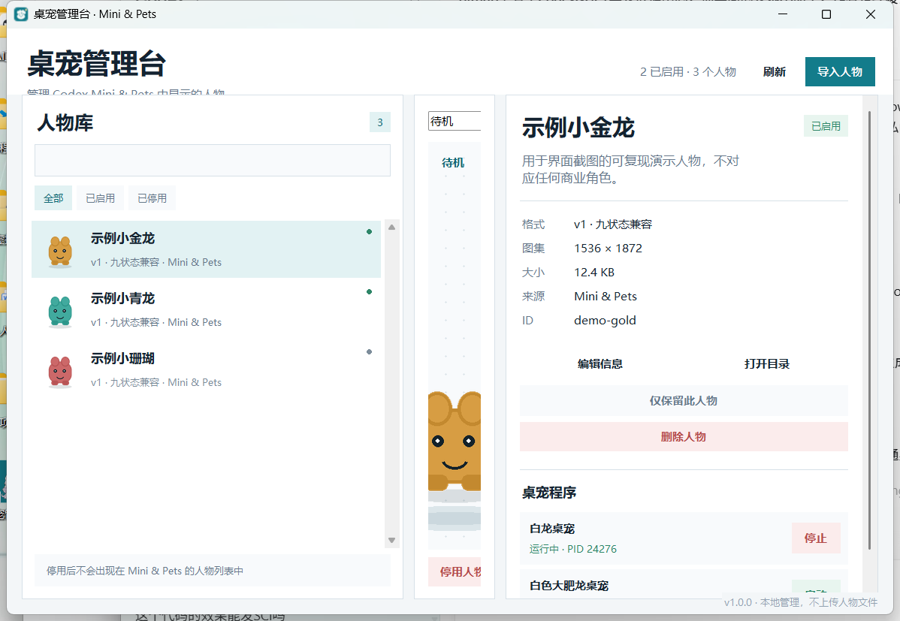

# Codex Pet Manager

一个用于管理 Codex **Mini & Pets** 本地人物的小型 Windows 桌面工具。



## 功能

- 扫描 `~/.codex/pets` 和 `~/.codex/avatars`
- 支持 `pet.json` 和 `avatar.json`
- 预览人物图集中的九种标准动画
- 启用或停用人物
- 仅保留指定人物
- 从 ZIP 或文件夹导入人物
- 修改人物名称和简介
- 删除人物配置和图集
- 启动或停止 BailongPet、dsh-pet

管理台通过移动本地人物目录来控制人物是否出现在 Mini & Pets 的候选中。最终显示哪个人物，仍然在 Codex 的 **设置 → Mini & Pets** 里选择。

## 直接运行

从 GitHub Releases 下载：

```text
CodexPetManager-v1.0.0-windows-x64.zip
```

完整解压后运行：

```text
CodexPetManager.exe
```

无需安装 Python，适用于 Windows 10/11 x64。

## 从源码运行

需要 Python 3.10 或更高版本。

```powershell
python -m pip install -r requirements.txt
python pet_manager.py
```

Windows 也可以直接双击 `run.bat`。

## 人物目录

启用中：

```text
%USERPROFILE%\.codex\pets
%USERPROFILE%\.codex\avatars
```

管理台停用目录：

```text
%USERPROFILE%\.codex\pet-manager\disabled
```

停用只是移动目录，不会删除人物文件。重新启用后会恢复。

## 人物包格式

目录至少包含：

```text
person/
├─ pet.json 或 avatar.json
└─ spritesheet.webp
```

示例：

```json
{
  "id": "my-pet",
  "displayName": "我的桌宠",
  "description": "本地桌宠人物",
  "spriteVersionNumber": 1,
  "spritesheetPath": "spritesheet.webp"
}
```

支持的图集尺寸：

- v1：`1536 × 1872`，九行动画
- v2：`1536 × 2288`，九行动画加十六方向

## 快捷键

- `Ctrl+R`：刷新
- `F2`：编辑当前人物
- `Delete`：删除当前人物

## 开发和测试

```powershell
python -m unittest discover -s tests -v
```

构建 Windows 单文件版本：

```powershell
.\build.ps1 -Version 1.0.0
```

产物位于 `release/`。

## 发布到 GitHub

仓库已经包含 `.github/workflows/build.yml`。推送 `v1.0.0` 标签后，Actions 会自动：

1. 运行测试
2. 构建 Windows 单文件程序
3. 打包免安装 ZIP
4. 创建 GitHub Release 和 SHA-256 校验文件

```powershell
git remote add origin https://github.com/<your-name>/<repo>.git
git push -u origin main
git tag v1.0.0
git push origin v1.0.0
```

## 隐私与数据

- 所有操作都在本机完成
- 不上传人物文件、聊天记录或 Codex 登录信息
- 不读取 API Key
- 不包含任何第三方桌宠素材

## 第三方素材

本项目只管理用户本机已有的人物文件，不附带其他仓库的角色动画、模型或美术资源。用户导入或管理的人物素材仍归各自作者所有，并受对应项目许可证约束。

## License

代码采用 MIT License，详见 [LICENSE](LICENSE)。
